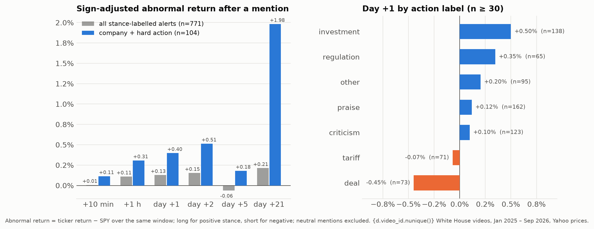
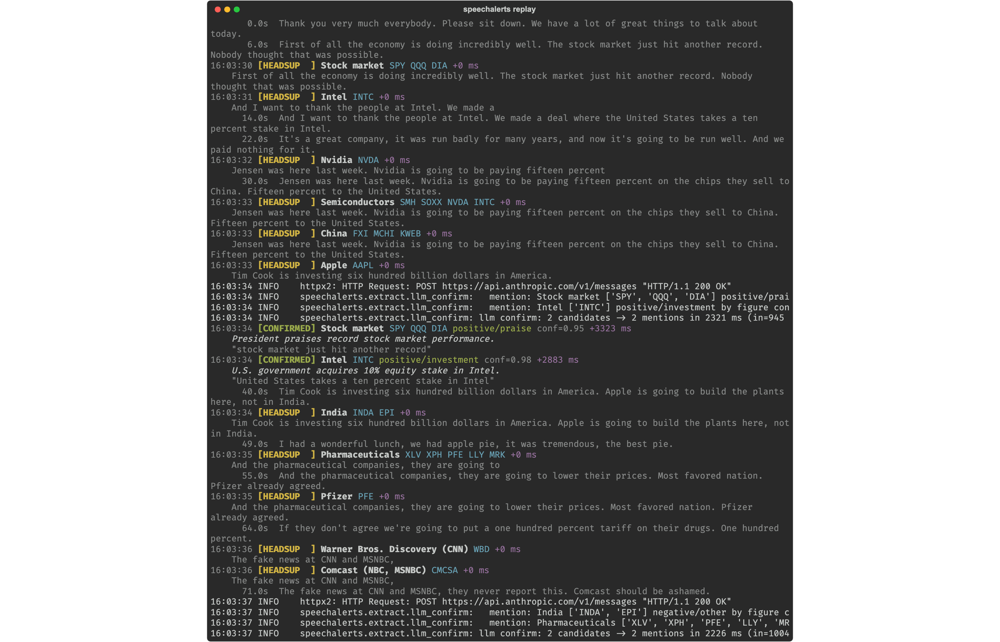
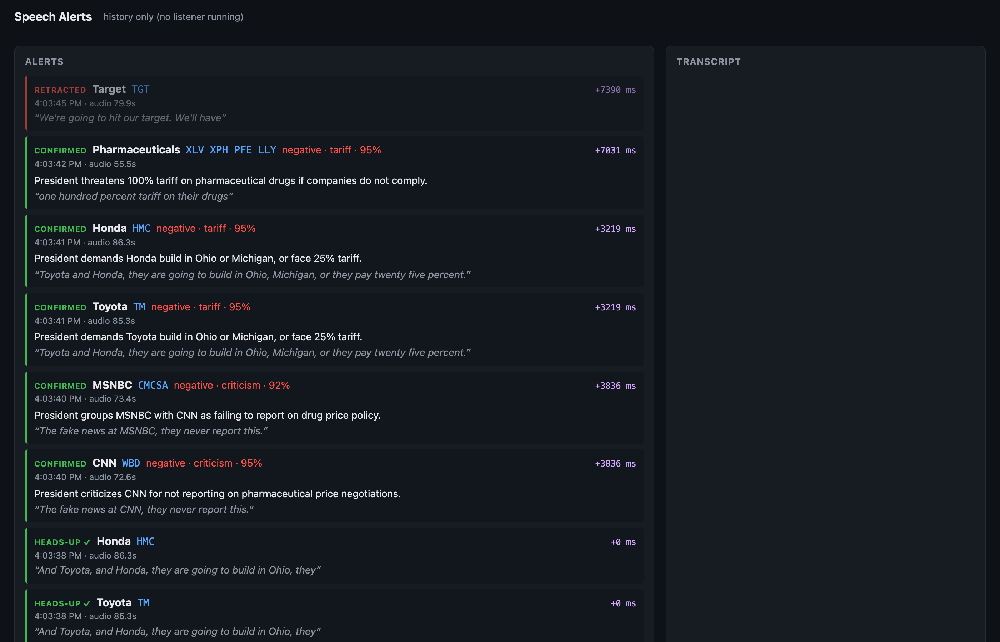

# Speech Alerts

Live-speech transcriber and notifier: detects company, ticker, sector and country mentions in a political speech the moment they are said. YouTube stream in, transcribed and classified alerts out within seconds, plus an offline backtest of whether those mentions move stock prices.

```
yt-dlp / HLS puller  ->  ffmpeg  ->  Deepgram streaming STT  ->  rolling transcript window
                                                                       |
            Aho-Corasick dictionary (HEADS-UP in < 1 ms)  ->  Claude confirmation (debounced 1 s)
            CONFIRMED with tickers, stance, action, quote  |  RETRACTED
                                                                       |
                      terminal  ·  local web page (SSE)  ·  SQLite audit log  ·  Firestore + FCM push
```

## Results

Measured on the project's golden sets and on 78 recorded White House livestreams. Details in [`docs/HANDOFF.md`](docs/HANDOFF.md) and [`strategy/FINDINGS.md`](strategy/FINDINGS.md).

| What | Result |
|---|---|
| Synthetic 84 s speech, real Deepgram + Claude | 11 of 11 mentions confirmed, 0 false positives; heads-up p50 0.7 s / p95 1.7 s after the audio arrives, confirmed p50 4.2 s / p95 10.5 s |
| Four golden transcripts (3 real speeches + 1 synthetic), Claude only | 18 of 18 expected mentions confirmed, 0 of 5 "must not fire" traps fired (reporter questions, a reporter's outlet, a mis-heard name) |
| Live YouTube streams | continuous transcript at the live edge; latency floor about 5 to 7 s because YouTube serves 5 s segments |
| Backtest, 78 videos / 74.5 h of speech, 979 measurable signals | on average mentions do not predict prices (+0.17 % next-day abnormal return, t ≈ 1.2). The one consistent pocket is a company named together with a hard action (investment, sanction, regulation, deal, tariff, subsidy): about +0.5 % next day, 55 % hit rate, sign stable across video groups |
| Unit tests | 74 in the live package, 19 in the backtest, no API keys needed |



The honest conclusion of the backtest: this is an information product ("know within seconds what was said about the names you hold"), not a trading signal. Alerts are factual records with a labelled stance, never advice.

## Screenshots

Terminal output of the demo replay (dictionary heads-ups in yellow, Claude confirmations in green with stance, action, confidence and latency):



Local web page served with the alert history (`speechalerts serve`):



## Key features

- **Two-tier alerts.** A dictionary hit over ~190 curated entities (companies, sectors to ETFs, countries to ETFs, executives to their company) fires a heads-up instantly; Claude confirms it with tickers, stance, action label and a verbatim quote, or retracts it. Context-gated aliases (`target`, `apple`, `meta`, media outlets) only fire near trigger words.
- **Speaker attribution.** Deepgram diarization picks the dominant speaker over a 5-minute window; names said by reporters get no heads-up and the model must return `speaker: figure` to confirm.
- **Live-edge YouTube puller.** Fetches AAC segments by sequence number and follows the `X-Head-Seqnum` header instead of letting ffmpeg re-download a 1 MB DVR playlist every 5 s. Handles auto-dubbed audio tracks, ad breaks and end-of-stream detection.
- **Always-on daemon.** `watch` polls channel `/live` pages, attaches when a title matches, retries after crashes while the stream is still live, and ignores videos that already ended. Ships with a launchd plist.
- **Four timestamps per alert** (audio position, audio arrival, transcript arrival, alert time) so latency is measurable per stage.
- **Zero-cost replay.** Saved transcripts replay through the dictionary and Claude without STT; `--no-llm` needs no keys at all.
- **Firebase sink.** Firestore feed, FCM topic pushes (dry-run by default), live transcript segments and a hosted terminal-style page.
- **Backtest and signal study** (`strategy/`): fetch, transcribe and replay recorded livestreams, judge expected direction with Claude, measure abnormal returns against SPY over 10 horizons, run a filter ladder and a $10k portfolio simulation.

## Tech stack

Python 3.12 with [uv](https://docs.astral.sh/uv/), asyncio. Deepgram Nova-3 streaming STT, Anthropic Claude (Haiku for confirmations, Sonnet for the backtest judge), pyahocorasick, pydantic, FastAPI + SSE, SQLite, rich, yt-dlp + ffmpeg, firebase-admin (Firestore, FCM, Hosting), pandas + yfinance for the backtest, pytest.

## How to run

```bash
brew install ffmpeg
git clone https://github.com/sinanhalef/speech-alerts.git && cd speech-alerts
cp .env.example .env            # fill DEEPGRAM_API_KEY and ANTHROPIC_API_KEY
uv sync                         # creates .venv with Python 3.12 and all deps
uv run pytest                   # 74 tests, no keys needed
```

Demo without any keys (dictionary tier only, saved transcript):

```bash
uv run python -m speechalerts replay --transcript eval/golden/synthetic_intel_speech.txt --speed 0 --no-llm
```

Full pipeline on the saved transcript (Claude only, no STT cost, about 15 s):

```bash
uv run python -m speechalerts replay --transcript eval/golden/synthetic_intel_speech.txt --speed 10
```

Live and recorded video:

```bash
# live stream or any YouTube page URL (auto-detects live vs recording)
uv run python -m speechalerts listen "https://www.youtube.com/watch?v=..."

# minutes 12 to 15 of a recording at 4x speed
uv run python -m speechalerts replay "https://www.youtube.com/watch?v=..." --from 12 --to 15 --speed 4

# always-on: poll the configured channels, attach when a matching stream goes live
uv run python -m speechalerts watch
uv run python -m speechalerts watch --any-title --once

# golden-set evaluation: precision, recall, latency
uv run python -m speechalerts eval --text      # transcripts only, Claude only
uv run python -m speechalerts eval             # with audio where available

# web page over the stored history only
uv run python -m speechalerts serve            # http://127.0.0.1:8000
```

The web page is on http://127.0.0.1:8000 whenever `listen`, `replay` or `watch` runs. `--no-web`, `--quiet` and `--interim` adjust the outputs. Tuning knobs (`LLM_MODEL`, `COOLDOWN_SECONDS`, `DIARIZE`, `WATCH_CHANNELS`, Firebase settings) are documented in `.env.example`.

Backtest (separate uv project, imports the live package read-only):

```bash
cd strategy
uv sync && uv run pytest
uv run backtest discover --days 75          # list recent White House livestreams
uv run backtest run-all                     # fetch, transcribe, extract, judge for every video in videos.yaml
uv run backtest measure && uv run backtest report && uv run backtest analyze && uv run backtest portfolio
```

Firebase sink and hosted page: see [`firebase/README.md`](firebase/README.md). Unattended operation on a Mac: see the comments in `deploy/com.speechalerts.watch.plist`.

## Project structure

```
speechalerts/            live package
  cli.py                listen | replay | watch | serve | eval | make-golden | build-entities
  pipeline.py           wiring; daemon.py: the always-on watch loop
  sources/              youtube (yt-dlp resolver), youtube_live (segment puller), ffmpeg_source, discovery
  stt/                  deepgram_stream, text_replay (fake STT for tests and eval)
  extract/              entities.yaml, dictionary (Aho-Corasick), llm_confirm (Claude)
  alerts/engine.py      dedupe, cooldown, heads-up / confirmed / retracted
  sinks/                terminal, sqlite, broadcast (SSE), firebase
  web/                  FastAPI app + static page
strategy/               backtest package (backtest/), signal study, FINDINGS.md, results and signals
eval/golden/            golden transcripts with expected and forbidden mentions
tests/                  unit tests for both packages
scripts/                SEC ticker import, schedule push, transcript backfill, result plot
firebase/               Firestore rules, hosting page (public/), project config
deploy/                 launchd plist for the watch daemon
docs/                   HANDOFF.md (design notes, bugs found, decisions), images/
```

## Legal notes that shape the code

- Alerts are factual records ("X said Y about Z at T") with a labelled stance. Not investment advice.
- Presidential remarks are public domain; broadcast recordings are not. The code stores short quotes and transcript segments for audit and never redistributes audio or full transcripts.
- Pulling audio with yt-dlp conflicts with YouTube's terms of service. Fine for a private tool; a shipped product must use official streams.
- "Speech Alerts" is a working name only.
